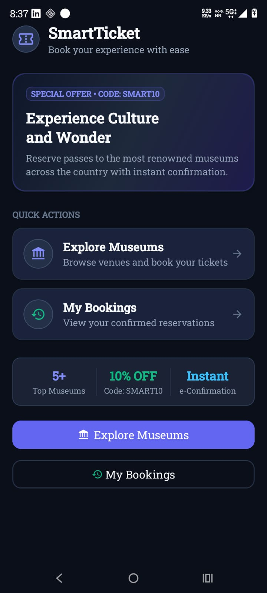
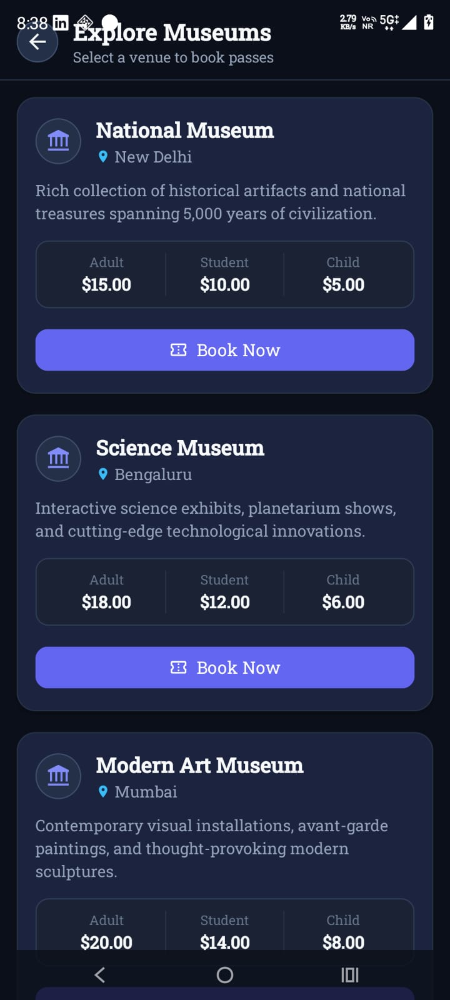
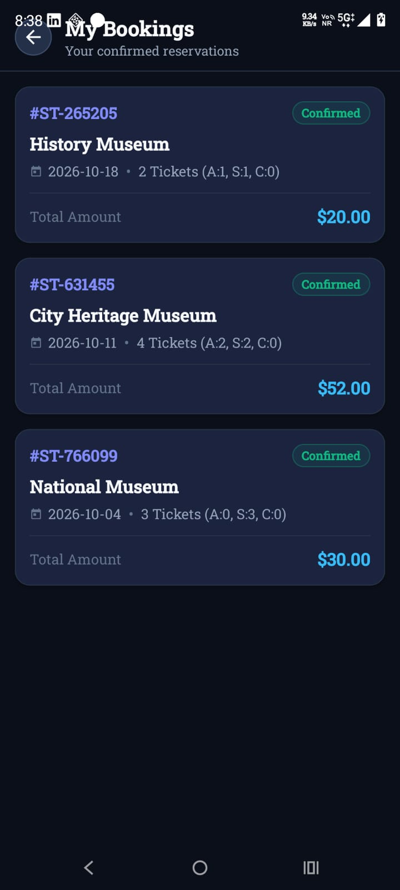

# 🎟️ SmartTicket

A native Android ticket booking application that allows users to explore museums, select tickets, calculate prices, apply discounts, and manage their booking history.

## 📱 Overview

SmartTicket is a Java-based Android application designed to provide a simple and convenient museum ticket-booking experience.

Users can browse available museums, select ticket quantities, choose a visit date, apply a discount coupon, confirm their booking, and view previous reservations.

## ✨ Features

- 🏛️ Browse available museums
- 📍 View museum locations and descriptions
- 🎟️ Select Adult, Student, and Child tickets
- 📅 Select a visit date
- 💰 Dynamic ticket price calculation
- 🏷️ `SMART10` coupon with 10% discount
- ✅ Booking confirmation
- 🔖 Unique booking ID generation
- 📋 View booking history
- 💾 Store bookings locally using SQLite
- 🌙 Modern dark-themed user interface

## 🛠️ Tech Stack

| Technology | Usage |
|---|---|
| Java | Application logic |
| XML | User interface layouts |
| Android SDK | Android application development |
| SQLite | Local booking data storage |
| SQLiteOpenHelper | Database management |
| Android Activities | Screen navigation |
| RecyclerView | Displaying lists |

## 📲 Application Flow

```text
Home
  │
  ├── Explore Museums
  │       │
  │       └── Select Museum
  │               │
  │               └── Book Tickets
  │                       │
  │                       ├── Select Date
  │                       ├── Select Ticket Quantities
  │                       ├── Apply Coupon
  │                       └── Confirm Booking
  │                               │
  │                               └── Booking Confirmation
  │
  └── My Bookings
          │
          └── View Booking History
```

## 💾 Database

SmartTicket uses SQLite for local data persistence.

Booking information includes:

- Booking ID
- Museum name
- Visit date
- Adult ticket count
- Student ticket count
- Child ticket count
- Total amount
- Booking status

The booking history remains available after closing and reopening the application.

## 🏗️ Project Structure

```text
SmartTicket/
│
├── app/
│   └── src/
│       └── main/
│           ├── java/
│           │   └── com.example.smartticket/
│           │       ├── activities/
│           │       ├── adapters/
│           │       ├── database/
│           │       ├── models/
│           │       └── MainActivity.java
│           │
│           └── res/
│
├── screenshots/
│   ├── home.jpeg
│   ├── museums.jpeg
│   └── bookings.jpeg
│
├── .gitignore
├── README.md
├── build.gradle.kts
├── gradle.properties
├── gradlew
├── gradlew.bat
└── settings.gradle.kts
```

## 📸 Screenshots

### 🏠 Home Screen



### 🏛️ Explore Museums



### 🎟️ My Bookings



## 🚀 How to Run

### Prerequisites

- Android Studio
- JDK
- Android SDK
- Android device or Android Emulator

### Steps

1. Clone this repository.
2. Open the project in Android Studio.
3. Allow Gradle to sync and download the required dependencies.
4. Connect an Android device with USB debugging enabled, or start an Android Emulator.
5. Select the device in Android Studio.
6. Click **Run ▶**.
7. The SmartTicket application will be installed and launched.

## 🧪 Testing

The application was tested on a physical Android device.

Tested functionality includes:

- Museum navigation
- Ticket quantity selection
- Date selection
- Price calculation
- Coupon application
- Booking confirmation
- Booking ID generation
- Booking history
- SQLite data persistence

## 🎟️ Sample Discount

Use the following coupon during booking:

```text
SMART10
```

This applies a **10% discount** to the booking amount.

## 🔮 Future Improvements

Possible future enhancements include:

- User authentication
- Online payment integration
- Cloud database synchronization
- Real-time museum availability
- QR-code based tickets
- Push notifications
- Online booking API integration
